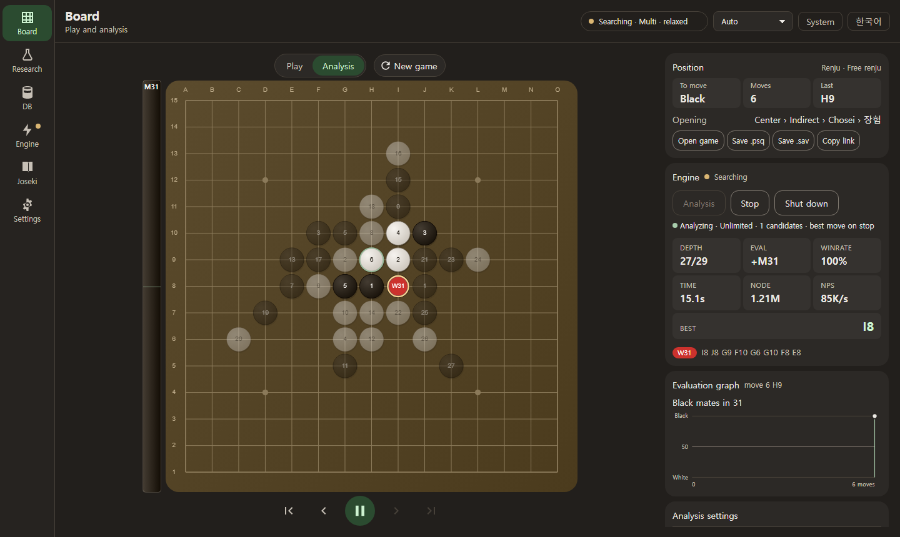
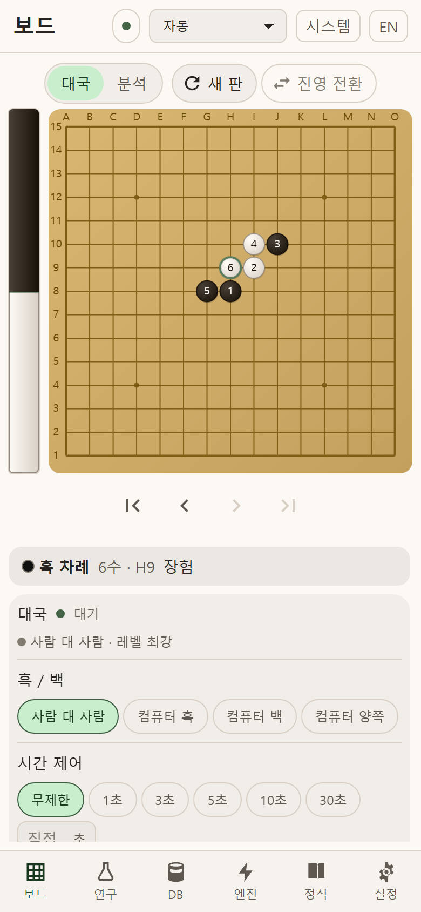

<div align="center">

# RapfiWeb

**세계 정상급 오목 · 렌주 엔진을 브라우저 하나로.**<br>
대국 · 분석 · 복기 · 연구까지. 서버도, 설치도, 계정도 필요 없다.

[**▶ 라이브 데모: rapfiweb.pages.dev**](https://rapfiweb.pages.dev)

[](https://github.com/lowqen/RapfiWeb/actions/workflows/web.yml)
[](https://github.com/lowqen/RapfiWeb/actions/workflows/deploy.yml)
[](LICENSE)
<br>
[](https://www.typescriptlang.org/)
[](https://react.dev/)
[](https://vite.dev/)
[](https://webassembly.org/)
[](https://pages.cloudflare.com/)

[English](README.md) · **한국어**



</div>

---

## 왜 RapfiWeb 인가

[Rapfi](https://github.com/dhbloo/rapfi) 는 가장 강한 오픈소스 오목 · 렌주 엔진 가운데 하나다(C++, NNUE 평가).
RapfiWeb 은 그것을 **WebAssembly** 로 옮기고 분석반 전체를 얹었다. 데스크톱 GUI 와 안드로이드
앱이 하던 일을 브라우저 탭 하나가 한다.

- **기기 밖으로 아무것도 나가지 않는다.** 기보 · 리뷰 · DB · 통계는 모두 IndexedDB 에 남는다.
- **정적 파일을 올릴 수 있는 곳이면 어디든.** 백엔드 · API 키 · 원격 수집이 없다.
- **빠르다.** 멀티스레드 SIMD 탐색, 약 20MB 가중치는 처음 한 번만 받는다.

## ✨ 핵심 기능

### 🧠 C++ 엔진을 WASM 멀티스레드로
- Emscripten 으로 **네 변형**을 빌드한다: `{단일, 멀티} 스레드 × {SIMD128, Relaxed SIMD}`.
  브라우저 능력을 재서 가장 빠른 것부터 띄우고, 안 되면 한 단계씩 물러선다.
- 교차 출처 격리(COOP/COEP)가 되면 `SharedArrayBuffer` 위의 pthread, 아니면 시간 분할 단일 스레드.
- 가중치는 한 번 받아 **SHA-256 으로 검증**한 뒤 Cache Storage 에서 꺼내 쓴다.
- 엔진 패치는 감이 아니라 측정으로 고른다. SPRT 대국 · 필승 묶음 · 고정 깊이 벤치가 CI 에서 돈다.
  배포 빌드는 순정 Rapfi WASM 빌드보다 **Elo +100**(1 스레드 · 수당 500ms, [분석](docs/gomocalc-대국-분석.md)).

### ⚡ 브라우저 안 고속 기보 변환
- RenjuNet 기보(`.rif`, 43MB, 약 11만 9천 판)를 **아무 화면에나 끌어다 놓으면** 워커가 바이트를
  스트리밍으로 읽고, 64비트 증분 Zobrist 해시로 국면을 세어 15MB 통계 팩을 만든다.
- **안드로이드 크롬 실기기 3.7초 · Celeron N4500 4.6초**, 워커 메모리 피크 50~57MB. 오프닝 빈도 ·
  선수/색/규칙별 랭킹 · 대국 목록이 곧바로 뜬다.
- 데스크톱 도구의 팩과 국면마다(116,191국면) 일치함을 대조했다.

### 📊 대국 자동 복기 · 11단계 착수 평가 리포트
- 국면마다 상위 두 후보를 읽고(`YXNBEST 2`), 수마다 **11등급**(명수 · 최선 … 실수 · 대실수 · 놓친 승리)과
  쪽마다 정확도를 매긴다.
- 여러 기보를 큐로 돌리고 국면마다 체크포인트를 남긴다. 탭을 닫아도 그 자리부터 잇는다.
- **CSV · Markdown · 한 파일 HTML 리포트**(판 · 형세 그래프 · 최악의 수)로 내보낸다.
- 그 밖에 필승을 증명하는 **AND/OR 국면 증명**, 지금 돌에 이르는 모든 수순을 세는 **수순 탐색**.

### 💾 완전한 클라이언트 사이드 · 로컬 영구 저장
- 두고 무른 수까지 자동 저장. 새로고침해도 이어진다.
- 엔진 자체의 국면 **DB**(yixindb)를 Emscripten 메모리 FS 와 IndexedDB 사이에서 주고받는다.
  주석 · 라벨 · `.db`/CSV 가져오기 · 내보내기.
- **정석 편집기**: 갈래 트리, 좌표 링크가 되는 마크다운 메모, 분류 자동, 대칭까지 보는 국면 찾기.
- `.psq` · `.sav` · `.pos` 열기/저장, `?p=h8i9j10` 국면 링크, 데스크톱 `settings.txt` 바이트 단위 왕복.

### 🌏 한국어 / 영어 · 반응형 · 접근성
- **한국어 · 영어 전체 UI**(문구 약 900개). 브라우저 언어 자동 감지와 단추 하나 전환. 시험이 소스를
  훑어 번역이 빠진 문구가 나가지 않게 한다.
- **360px 휴대폰부터 데스크톱까지**, 세로 · 가로, 라이트 · 다크.
- **접근성 기본 탑재**: 모든 판에서 키보드 착수(방향키 + Enter), 화면 읽기 안내, 뜨면 초점을 받고 Esc 로
  닫히는 확인 상자, 24px 이상 터치 타깃, 두 테마 모두 **명암비 4.5:1**. Playwright 스모크가 지킨다.

<div align="center">

</div>

## 🏗 아키텍처

```
┌──────────────────────────── 브라우저 탭 (메인 스레드) ─────────────────────────────┐
│                                                                                    │
│   React 18 UI ── Zustand 스토어 ── Canvas 2D 보드 (2 레이어)                       │
│        │                │                                                          │
│        │                └── Dexie ──► IndexedDB  games · reviews · queue · joseki  │
│        │                                         dbfiles · packs                   │
│        │ EngineClient (타입 있는 메시지, 국면 키가 붙은 답)                        │
└────────┼───────────────────────────────────────────────────────────────────────────┘
         │ postMessage
┌────────▼──────────────── 엔진 Web Worker ─────────────────────┐   ┌─ 다른 워커 ─────┐
│  engine-worker.ts                                             │   │ rif.worker      │
│    ├─ Gomocup / Yixin 텍스트 프로토콜 (sendCommand ↔ 줄)      │   │  .rif → 팩      │
│    ├─ weights-cache: Cache Storage + SHA-256 → rapfi.data     │   │ moveOrder.worker│
│    └─ Emscripten 모듈 (Rapfi C++ → WASM)                      │   │  수순 DAG       │
│         ├─ MEMFS  /rapfi.db  ◄── 동기화 ──► IndexedDB         │   └─────────────────┘
│         └─ SharedArrayBuffer 위의 pthread (멀티 변형)         │
└───────────────────────────────────────────────────────────────┘
```

- **엔진의 주인은 하나.** WASM 모듈은 워커만 만진다. UI 는 명령을 보내고, 답의 국면 키가 지금 판과
  맞을 때만 그린다. 무른 뒤에 지난 분석이 번쩍이지 않는다.
- **배타 모드.** 대국 · 분석 · 리뷰 · 증명이 자물쇠 하나로 엔진을 나눠 쓰고, 모드마다 비키는 법을 안다.
- **변형 폴백.** relaxed 멀티 → 멀티 → relaxed 단일 → 단일. 능력 탐지와 예열 핸드셰이크로 정한다.
  WASM SIMD 가 없는 브라우저에는 안내 화면을 띄운다.

| 층 | 기술 |
|---|---|
| UI | React 18, React Router 6, Zustand 5, Canvas 2D, TS 에서 생성하는 디자인 토큰 |
| 엔진 | Rapfi (C++) → Emscripten → WASM SIMD128 / Relaxed SIMD, pthread |
| 저장 | Dexie 4 (IndexedDB), 가중치는 Cache Storage |
| 품질 | TypeScript strict, Vitest (시험 파일 50개 이상), Playwright 스모크, ESLint, Prettier |
| 배포 | GitHub Actions → Cloudflare Pages (스레드용 COOP/COEP 헤더) |

## 🚀 시작하기

**필요한 것:** Node.js 20.11 이상(CI 는 26)과 pnpm.

```bash
git clone https://github.com/lowqen/RapfiWeb.git
cd RapfiWeb
pnpm install

# 엔진 가중치(~20MB)는 git 이 아니라 릴리스 자산이다.
# 태그는 src/engine/engine-manifest.json 의 tag 와 같아야 한다.
gh release download engine-3c94c2a9-w8 --dir public/engine --pattern 'rapfi.data'

pnpm dev          # http://localhost:5173
```

`rapfi.data` 가 없어도 UI 는 뜬다. 엔진 표시가 오류를 말할 뿐이다.

| 명령 | 하는 일 |
|---|---|
| `pnpm dev` | 디자인 토큰 생성 + Vite 개발 서버 |
| `pnpm build` | 토큰 · 타입 검사 · 프로덕션 빌드(`dist/`) |
| `pnpm preview` | 프로덕션 빌드를 로컬에서 띄운다 |
| `pnpm test` | 단위 시험(Vitest) |
| `pnpm check` | 타입 검사 · 린트 · 시험 · 빌드를 CI 순서로 |
| `pnpm engine:build` | WASM 엔진을 소스에서 다시 빌드(리눅스 x86_64, Emscripten) |

Cloudflare Pages 배포는 [`deploy.yml`](.github/workflows/deploy.yml) 이 자동으로 한다. 처음 한 번의 설정은
[`docs/배포-cloudflare.md`](docs/배포-cloudflare.md).

### 브라우저 요구사항

WebAssembly SIMD 가 필수다: **Chrome/Edge 91+, Firefox 89+, Safari 16.4+**. 멀티스레드는 교차 출처 격리
(`public/_headers`)가 더 필요하고, 그것이 안 되는 호스팅에서는 단일 스레드 엔진으로 저절로 물러선다.

이 웹 빌드는 **렌주** 가중치만 싣는다(Cloudflare 파일당 25MB 상한).

## 📚 문서

| 문서 | 내용 |
|---|---|
| [`docs/기능-안내.md`](docs/기능-안내.md) | 화면별 상세 기능 안내 |
| [`docs/최적화-마스터플랜.md`](docs/최적화-마스터플랜.md) | 엔진 최적화 기록: 패치마다 측정과 판정 |
| [`docs/gomocalc-대국-분석.md`](docs/gomocalc-대국-분석.md) | Elo +100 의 근거가 된 대국 분석 |
| [`public/engine/README.md`](public/engine/README.md) | 엔진 변형 · 빌드 출처 · 가중치 캐시 |

## ⚖️ 라이선스와 자료

배포물에 Rapfi 엔진이 들어 있으므로 **[GNU GPL v3.0 이상](LICENSE)** 으로 배포한다. 이 저장소가 직접 쓴
코드는 BSD 2-Clause 로도 쓸 수 있다. 함께 싣거나 이식한 구성요소(Rapfi · rapfi-networks · Yixin-Board ·
RapfiDroid · npm 의존성)와 엔진의 대응 소스 위치는 [**THIRD_PARTY_NOTICES.md**](THIRD_PARTY_NOTICES.md) 에 있다.

**RenjuNet 자료는 절대 싣지 않는다.** 라이선스가 비상업 · 오프라인 사용만 허락하므로, 앱은 *사용자가 가진*
파일을 *그 브라우저 안에서만* 처리하고 아무것도 올리지 않는다. `.gitignore` 와 CI 게이트가 `.rif` 파생
파일을 저장소와 모든 배포물에서 막는다.

## 🙏 감사

- [**dhbloo/rapfi**](https://github.com/dhbloo/rapfi) · [**rapfi-networks**](https://github.com/dhbloo/rapfi-networks): 엔진과 가중치
- Kai Sun 의 [**Yixin-Board**](https://github.com/accreator/Yixin-Board) 와 [dhbloo 의 fork](https://github.com/dhbloo/Yixin-Board): 프로토콜과 리뷰 로직을 따른 데스크톱 GUI
- [**RapfiDroid**](https://github.com/lowqen/RapfiDroid): 이 웹 앱의 원본인 안드로이드 분석반
